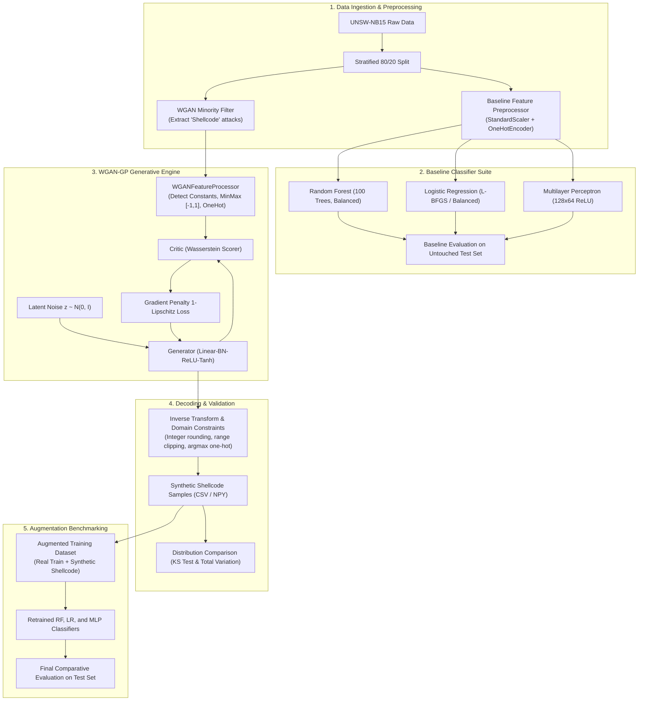

# Dynamic-CS-WGAN-GP-IDS

> **Research implementation of a Dynamic Cost-Sensitive Wasserstein GAN with Gradient Penalty (WGAN-GP) using Stackelberg Game Theory for Robust Network Intrusion Detection.**

[](https://www.python.org/)
[](https://pytorch.org/)
[](https://scikit-learn.org/)
[](https://research.unsw.edu.au/projects/unsw-nb15-dataset)
[](LICENSE)

---

## 📌 Table of Contents
1. [Project Overview & Aim](#-project-overview--aim)
2. [The Core Problem: Class Imbalance in NIDS](#-the-core-problem-class-imbalance-in-nids)
3. [Dataset Architecture: UNSW-NB15](#-dataset-architecture-unsw-nb15)
4. [Technical Architecture](#-technical-architecture)
   - [Pipeline Flow](#pipeline-flow)
   - [WGAN-GP Model Specifications](#wgan-gp-model-specifications)
   - [Tabular Feature Processor & Inverse Decoder](#tabular-feature-processor--inverse-decoder)
5. [Completed Work & Milestones](#-completed-work--milestones)
6. [Experimental Results & Benchmarks](#-experimental-results--benchmarks)
   - [Baseline Classifier Performance](#baseline-classifier-performance)
   - [WGAN-GP Augmentation Comparison](#wgan-gp-augmentation-comparison)
   - [Statistical Distribution Fidelity](#statistical-distribution-fidelity)
7. [Repository Structure](#-repository-structure)
8. [Installation & Setup](#-installation--setup)
9. [Usage Guide](#-usage-guide)
10. [Roadmap & Theoretical Future Work](#-roadmap--theoretical-future-work)

---

## 🎯 Project Overview & Aim

Modern Network Intrusion Detection Systems (NIDS) powered by deep learning and machine learning often fail in real-world security operations due to two fundamental hurdles:
1. **Severe Class Imbalance**: Stealthy and high-consequence attacks (such as Shellcode, Zero-days, or Worms) appear in negligible quantities compared to normal traffic or high-volume attacks (e.g., Generic floods), leading classifiers to systematically miss low-frequency threats.
2. **Adversarial Evasion & Non-Static Threats**: Attackers continuously modify traffic characteristics to deceive detection boundaries without altering attack functionality.

### Core Objective
This project designs and implements an end-to-end framework that:
* Accurately models the complex, mixed-type distribution of minority network flow records using **Wasserstein GANs with Gradient Penalty (WGAN-GP)**.
* Synthesizes realistic, domain-valid flow samples adhering to strict protocol semantics and integer packet constraints.
* Integrates **Dynamic Cost-Sensitive (CS)** learning and **Stackelberg Game Theory** to balance detection costs and simulate a game between an adaptive attacker (Generator) and an optimal defensive classifier (Critic/IDS).

---

## ⚠️ The Core Problem: Class Imbalance in NIDS

In typical enterprise telemetry, legitimate network traffic and common automated attacks dominate the log volume. Under-represented attacks like **Shellcode** make up less than **0.6%** of total traffic. Standard empirical risk minimization causes classifiers to:
* Optimize solely for overall accuracy while suffering high **False Negative Rates (FNR)** on rare attacks.
* Experience catastrophic recall drops when encountering variations of minority attack categories.

Traditional oversampling (e.g., SMOTE, ADASYN) generates synthetic points through naive linear interpolation. In network telemetry, this produces illegal and impossible network artifacts (e.g., fractional packet counts, non-existent protocol states, or negative connection durations). **WGAN-GP with domain-aware decoding overcomes these limitations.**

---

## 📊 Dataset Architecture: UNSW-NB15

The framework is built and validated on the **UNSW-NB15** benchmark dataset, generated by the Australian Centre for Cyber Security (ACCS) using IXIA PerfectStorm to capture modern network behaviors across 45 fields.

### Partitioning & Volume
* **Training Set (`UNSW_NB15_training-set.csv`)**: 175,341 records (119,341 Attack, 56,000 Normal)
* **Testing Set (`UNSW_NB15_testing-set.csv`)**: 82,332 records (45,332 Attack, 37,000 Normal)
* **Internal Split**: 80/20 stratified split of training data for validation.

### Attack Distribution & Minority Class Focus
The dataset comprises 9 distinct attack vectors:
```
Normal         : 56,000  (31.94%)
Generic        : 40,000  (22.81%)
Exploits       : 33,393  (19.04%)
Fuzzers        : 18,184  (10.37%)
DoS            : 12,264  (6.99%)
Reconnaissance : 10,491  (5.98%)
Analysis       :  2,000  (1.14%)
Backdoor       :  1,746  (1.00%)
Shellcode      :  1,133  (0.65%)  <-- Primary target class for generative synthesis
Worms          :    130  (0.07%)
```

### Feature Categories (45 Attributes)
* **Identifiers & Target**: `id`, `attack_cat`, `label`
* **Flow & Protocol Identifiers**: `proto` (protocol), `service` (http, ftp, etc.), `state` (connection state)
* **Basic Flow Attributes**: `dur` (duration), `spkts`/`dpkts` (packet counts), `sbytes`/`dbytes` (byte volumes), `rate`, `sttl`/`dttl` (TTL), `sload`/`dload`, `sloss`/`dloss`
* **Jitter & Packet Timing**: `sinpkt`/`dinpkt` (inter-packet arrival), `sjit`/`djit` (jitter)
* **TCP Handshake Dynamics**: `swin`/`dwin` (TCP window sizes), `stcpb`/`dtcpb` (sequence numbers), `tcprtt`, `synack`, `ackdat`
* **Content & Payload Indicators**: `smean`/`dmean` (mean packet size), `trans_depth`, `response_body_len`
* **Aggregated Window Statistics**: `ct_srv_src`, `ct_state_ttl`, `ct_dst_ltm`, `ct_src_dport_ltm`, `ct_dst_sport_ltm`, `ct_dst_src_ltm`, `ct_src_ltm`, `ct_srv_dst`
* **Application Indicators**: `is_ftp_login`, `ct_ftp_cmd`, `ct_flw_http_mthd`, `is_sm_ips_ports`

---

## 🏗️ Technical Architecture

### Pipeline Flow



---

### WGAN-GP Model Specifications

The generator and critic avoid the instability of classic GANs (such as mode collapse and vanishing gradients) by optimizing the **Wasserstein distance** enforced via a **Gradient Penalty**:

$$\min_{G} \max_{D \in \mathcal{D}_L} \underset{x \sim \mathbb{P}_r}{\mathbb{E}}[D(x)] - \underset{\tilde{x} \sim \mathbb{P}_g}{\mathbb{E}}[D(\tilde{x})] - \lambda \underset{\hat{x} \sim \mathbb{P}_{\hat{x}}}{\mathbb{E}}\left[(\|\nabla_{\hat{x}} D(\hat{x})\|_2 - 1)^2\right]$$

* **Latent Dimension**: 64
* **Critic Steps ($n_{\text{critic}}$)**: 5 updates per 1 generator step
* **Gradient Penalty Weight ($\lambda$)**: 10.0
* **Learning Rate**: $1 \times 10^{-4}$ with Adam ($\beta_1 = 0.0, \beta_2 = 0.9$)
* **Architectures ([wgan_gp/models.py](file:///d:/GT/Dynamic-CS-WGAN-GP-IDS/wgan_gp/models.py))**:
  * **Generator**: `Linear(64, 256)` $\to$ `BatchNorm1d` $\to$ `ReLU` $\to$ `Linear(256, 128)` $\to$ `BatchNorm1d` $\to$ `ReLU` $\to$ `Linear(128, D_out)` $\to$ `Tanh`
  * **Critic**: `Linear(D_in, 256)` $\to$ `LeakyReLU(0.2)` $\to$ `Linear(256, 128)` $\to$ `LeakyReLU(0.2)` $\to$ `Linear(128, 1)` (unrestricted scalar output)

---

### Tabular Feature Processor & Inverse Decoder

A core contribution of this repository is the **`WGANFeatureProcessor`** ([wgan_gp/feature_preprocessing.py](file:///d:/GT/Dynamic-CS-WGAN-GP-IDS/wgan_gp/feature_preprocessing.py)):
1. **Constant Feature Isolation**: Columns with zero variance within the target subset are isolated and re-injected post-generation, preventing the GAN from learning redundant invariants.
2. **MinMax Normalization**: Scales continuous values to $[-1, 1]$ to match the `Tanh` activation function.
3. **Domain Range Clipping**: Closes generation leaks by strictly clipping synthetic values to empirical $[\min, \max]$ boundaries.
4. **Integer Preservation**: Applies round-to-nearest integer transformation (`np.rint`) on 24 discrete protocol count/sequence fields (`spkts`, `dpkts`, `sbytes`, `sttl`, `ct_srv_src`, etc.).
5. **Categorical Argmax Decoding**: Reconstructs one-hot categorical blocks (`proto`, `service`, `state`) into valid protocol tokens.

---

## ✅ Completed Work & Milestones

* [x] **Phase 1: Preprocessing & Data Cleaning**
  * Automated loading and cleaning pipelines for the full UNSW-NB15 dataset.
  * Preserved attack taxonomy for post-hoc per-attack category recall auditing.
* [x] **Phase 2: Baseline Model Architecture**
  * Trained and persisted Random Forest, Logistic Regression, and MLP classifiers on an 80/20 stratified split.
  * Established comprehensive baseline evaluation metrics on the untouched test set.
* [x] **Phase 3: WGAN-GP Training Engine**
  * Built PyTorch WGAN-GP implementation with 1-Lipschitz gradient penalty.
  * Checkpoint logging every 25 epochs with loss tracking.
* [x] **Phase 4: Domain-Aware Inverse Transformation**
  * Implemented boundary clipping, integer rounding, and categorical recovery.
  * Verified output data integrity (0 missing values, 0 infinite values, valid domain bounds).
* [x] **Phase 5: Distributional Validation Suite**
  * Kolmogorov-Smirnov (KS) two-sample test for continuous feature fidelity.
  * Total Variation Distance (TVD) for categorical consistency.
  * Generated distribution density plots comparing real vs. synthetic Shellcode flows.
* [x] **Phase 6: Augmentation Benchmarking**
  * Retrained classifiers on combined datasets (Real Train + 1,000 Synthetic Shellcode samples).
  * Validated detection performance improvements on the untouched test set.

---

## 📈 Experimental Results & Benchmarks

### Baseline Classifier Performance
Evaluated on the full, untouched test set (82,332 records; 45,332 attacks, 37,000 normal):

| Model | Accuracy | Precision | Recall | F1 Score | ROC-AUC | FPR | FNR |
| :--- | :---: | :---: | :---: | :---: | :---: | :---: | :---: |
| **Random Forest** | **89.34%** | **85.26%** | 97.50% | **0.9097** | **0.9811** | **20.65%** | 2.50% |
| **MLP (128x64)** | 85.66% | 80.42% | **97.77%** | 0.8825 | 0.9763 | 29.17% | **2.23%** |
| **Logistic Regression** | 83.56% | 80.27% | 93.00% | 0.8617 | 0.9557 | 28.01% | 7.00% |

#### Per-Attack Category Recall (Random Forest Baseline):
```
Analysis       (677 samples)   : 99.70%
Backdoor       (583 samples)   : 100.00%
DoS            (4,089 samples) : 99.80%
Exploits       (11,132 samples): 99.34%
Fuzzers        (6,062 samples) : 82.89%
Generic        (18,871 samples): 99.99%
Reconnaissance (3,496 samples) : 99.91%
Shellcode      (378 samples)   : 97.62%  <-- Weakest minority attack recall
Worms          (44 samples)    : 100.00%
```

---

### WGAN-GP Augmentation Comparison
Benchmarking models trained on **Real Training Data** vs. **Real + 1,000 WGAN-GP Synthetic Shellcode Samples**:

| Experiment | Accuracy | Precision | Overall Recall | F1 Score | **Shellcode Recall** | FPR |
| :--- | :---: | :---: | :---: | :---: | :---: | :---: |
| **Baseline Random Forest** | **89.34%** | **85.26%** | 97.50% | 0.9097 | 97.62% | 20.65% |
| **WGAN-GP Augmented RF** | 89.32% | 85.24% | 97.49% | 0.9095 | **98.41% (+0.79%)** | 20.68% |
| **Baseline MLP** | 85.66% | 80.42% | 97.77% | 0.8825 | 97.62% | 29.17% |
| **WGAN-GP Augmented MLP** | **85.83%** | **80.47%** | **98.07%** | **0.8840** | **98.94% (+1.32%)** | 29.16% |

> **Key Takeaway**: Augmenting the training set with WGAN-GP synthetic samples increased minority Shellcode detection from **97.62% to 98.94%** on MLP and to **98.41%** on Random Forest without inflating the False Positive Rate.

---

### Statistical Distribution Fidelity
Evaluated on synthetic samples generated at epoch 100 vs. real training Shellcode samples:

* **Categorical Distribution (Total Variation Distance - TVD)**:
  * `service`: **0.0000** (Exact match)
  * `proto`: **0.0112** (Near-identical distribution)
  * `state`: **0.0212** (Near-identical distribution)
* **Numerical Distribution (Kolmogorov-Smirnov Distance - KS)**:
  * Features with near-exact convergence ($\text{KS} \le 0.05$): `sttl` (0.000), `trans_depth` (0.000), `ct_src_dport_ltm` (0.000), `dloss` (0.011), `ct_state_ttl` (0.021), `sloss` (0.051).
  * High-variance features: `spkts` (0.141), `sbytes` (0.159), `dur` (0.343), `dload` (0.488).

---

## 📂 Repository Structure

```
Dynamic-CS-WGAN-GP-IDS/
├── baseline/
│   ├── models/                           # Serialized models (.pkl) & validation data
│   │   ├── logistic_regression.pkl
│   │   ├── mlp.pkl
│   │   ├── random_forest.pkl
│   │   └── preprocessor.pkl
│   ├── evaluate.py                       # Evaluates baselines on test set
│   └── train.py                          # Fits baseline classifiers
├── data/
│   ├── raw/                              # Place UNSW_NB15 CSV files here (gitignored)
│   └── attack_distribution.png           # Attack frequency plot
├── notebooks/
│   └── dataset_analysis.ipynb            # Exploratory Data Analysis
├── preprocessing/
│   └── preprocess.py                     # Initial feature transformations
├── results/
│   ├── baseline_results.csv              # Overall baseline metrics
│   ├── wgan_gp_augmentation_comparison.csv # Baseline vs Augmented results
│   ├── wgan_gp_distribution_comparison.csv # KS and TVD statistical metrics
│   └── *_attack_category_results.csv     # Granular attack category recall tables
├── wgan_gp/
│   ├── compare_augmentation.py           # Augmentation experiment suite
│   ├── compare_distributions.py          # Distribution fidelity analysis
│   ├── config.py                         # Hyperparameters & paths
│   ├── data_utils.py                     # Split reproduction & category slicing
│   ├── feature_preprocessing.py          # Domain-aware WGAN feature processor
│   ├── generate.py                       # Sample generator & inverse decoder
│   ├── losses.py                         # Wasserstein loss & gradient penalty
│   ├── models.py                         # PyTorch Generator & Critic
│   ├── train.py                          # WGAN-GP training loop
│   └── validate_synthetic.py             # Integrity & boundary validation
├── .gitignore
├── LICENSE
└── README.md
```

---

## 💻 Installation & Setup

### Prerequisites
* Python 3.10 or higher
* Recommended: CUDA-capable GPU (CPU execution is fully supported)

### 1. Clone the Repository
```bash
git clone https://github.com/manu131415/Dynamic-CS-WGAN-GP-IDS.git
cd Dynamic-CS-WGAN-GP-IDS
```

### 2. Create and Activate a Virtual Environment
```bash
python -m venv venv

# Windows
.\venv\Scripts\activate

# Linux / macOS
source venv/bin/activate
```

### 3. Install Dependencies
```bash
pip install torch numpy pandas scikit-learn scipy matplotlib joblib
```

### 4. Download Dataset
Download the **UNSW-NB15** CSVs and place them in `data/raw/`:
* `data/raw/UNSW_NB15_training-set.csv`
* `data/raw/UNSW_NB15_testing-set.csv`

---

## 🚀 Usage Guide

Run all commands from the project root:

### 1. Train and Evaluate Baselines
```bash
# Train Random Forest, Logistic Regression, and MLP baselines
python -m baseline.train

# Evaluate baseline models and generate attack category recall tables
python -m baseline.evaluate
```

### 2. Train the WGAN-GP
```bash
# Train on target minority class (Shellcode by default)
python -m wgan_gp.train --epochs 100 --batch-size 64
```

### 3. Generate Synthetic Samples
```bash
# Generate 1,000 synthetic Shellcode records from checkpoint epoch 100
python -m wgan_gp.generate --epoch 100 --samples 1000 --batch-size 64
```

### 4. Validate Synthetic Quality & Statistical Fidelity
```bash
# Run data integrity, domain boundary, and type checks
python -m wgan_gp.validate_synthetic

# Compute KS statistics, TVD, and generate distribution histograms
python -m wgan_gp.compare_distributions
```

### 5. Benchmark Augmentation Performance
```bash
# Train augmented models and compare head-to-head against baselines
python -m wgan_gp.compare_augmentation
```

---

## 🔮 Roadmap & Theoretical Future Work

Building on the current generative foundation, this project is expanding into game-theoretic and dynamic cost optimization:

```
[Phase 1 & 2: Preprocessing + Baselines]   --> COMPLETED
[Phase 3 & 4: WGAN-GP + Domain Decoding]  --> COMPLETED
[Phase 5: Augmentation Benchmarking]      --> COMPLETED
     │
     ▼
[Phase 6: Dynamic Cost-Sensitive Learning (CS-WGAN-GP)]
     │  - Integrate cost matrix C(y, y_pred) dynamically adjusted per epoch
     │  - Weight generator/critic feedback using misclassification severity
     ▼
[Phase 7: Stackelberg Game-Theoretic Equilibrium]
     │  - Model Leader (IDS Defender) and Follower (Adversarial Generator)
     │  - Compute Stackelberg Equilibrium for worst-case robust defense
```

1. **Dynamic Cost-Sensitive (CS) Weighting**:
   * Implement an asymmetric loss function penalizing False Negatives on rare, catastrophic attacks ($C_{\text{FN}} \gg C_{\text{FP}}$) dynamically derived from evasion difficulty.
2. **Stackelberg Game Formulation**:
   * Formulate the interplay between the IDS Defender (Leader) and the Generative Attacker (Follower) as a bilevel optimization game, computing equilibrium strategies where the defender minimizes evasion risk against an optimal evasion adversary.
3. **Multi-Category Generative Expansion**:
   * Extend the target category beyond Shellcode to multi-minority attacks (`Worms`, `Backdoor`, `Analysis`).
