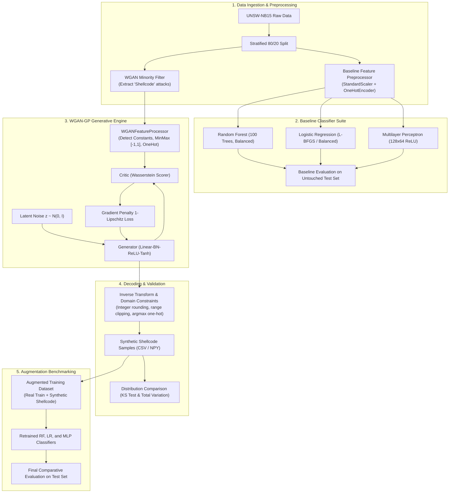

# Dynamic-CS-WGAN-GP-IDS

> **Research implementation of a Dynamic Cost-Sensitive Wasserstein GAN with Gradient Penalty (WGAN-GP) using Stackelberg Game Theory for Robust Network Intrusion Detection.**

[](https://www.python.org/)
[](https://pytorch.org/)
[](https://scikit-learn.org/)
[](https://research.unsw.edu.au/projects/unsw-nb15-dataset)
[](LICENSE)

---

## 📌 Table of Contents
1. [Project Overview & Aim](#-project-overview--aim)
2. [Project Status at a Glance](#-project-status-at-a-glance)
## 🧭 Project Status at a Glance

| Stage | Status | Headline result |
| :--- | :---: | :--- |
| Preprocessing + baselines (RF / LR / MLP) | ✅ Done | RF: 89.3% accuracy, ROC-AUC 0.981, but FPR ≈ 20.7% on the shifted test file |
| WGAN-GP for Shellcode + augmentation benchmark | ✅ Done (single seed) | Shellcode recall +0.8 to +1.3 pts (≈ 3–5 of 378 test flows); **needs multi-seed confirmation** |
| Cost-sensitive study: static / dynamic / threshold / feedback / 5-seed test | ✅ Done | Cost weighting moves the operating point but does not improve ranking quality; feedback restores baseline-level ranking and does not exceed it |
| Gate diagnostic (scarcity vs. shift vs. overlap) | ✅ Done | Fuzzers = train→test **shift** (not scarcity); Shellcode = scarce with almost no shift; normal traffic itself is shifted (domain AUC 0.90) |
| WGAN-GP extension + Experiment 4 (A / D / W / W+D) | ⏳ Next | |
| Stackelberg defender–attacker stage | ⏳ Planned | Adversarial-robustness study, see [roadmap](#-roadmap--role-of-the-stackelberg-stage) |
| Final evaluation + write-up | ⏳ Planned | |

**Honest summary so far.** Cost-aware training on UNSW-NB15 trades false alarms for recall (an operating-point shift) rather than improving how well flows are ranked. A feedback loop recovers the baseline's ranking quality after weighting damages it, but does not beat the plain baseline. The weakest class is **Fuzzers** (recall at 10% FPR of only 0.47–0.55), which is *not* a scarce class (10.4% of training data). The gate diagnostic confirms that the Fuzzers weakness is train→test distribution shift, so synthetic data drawn from the training set is unlikely to fix it; generation should target the genuinely scarce classes instead (Shellcode first).

---

3. [The Core Problem: Class Imbalance in NIDS](#-the-core-problem-class-imbalance-in-nids)
4. [Dataset Architecture: UNSW-NB15](#-dataset-architecture-unsw-nb15)
5. [Technical Architecture](#-technical-architecture)
   - [Pipeline Flow](#pipeline-flow)
   - [WGAN-GP Model Specifications](#wgan-gp-model-specifications)
   - [Tabular Feature Processor & Inverse Decoder](#tabular-feature-processor--inverse-decoder)
6. [Completed Work & Milestones](#-completed-work--milestones)
7. [Experimental Results & Benchmarks](#-experimental-results--benchmarks)
   - [Baseline Classifier Performance](#baseline-classifier-performance)
   - [WGAN-GP Augmentation Comparison](#wgan-gp-augmentation-comparison)
   - [Statistical Distribution Fidelity](#statistical-distribution-fidelity)
8. [Cost-Sensitive & Feedback Experiments](#-cost-sensitive--feedback-experiments)
9. [Repository Structure](#-repository-structure)
10. [Installation & Setup](#-installation--setup)
11. [Usage Guide](#-usage-guide)
12. [Roadmap & Role of the Stackelberg Stage](#-roadmap--role-of-the-stackelberg-stage)

---

## 🎯 Project Overview & Aim

Modern Network Intrusion Detection Systems (NIDS) powered by deep learning and machine learning often fail in real-world security operations due to two fundamental hurdles:
1. **Severe Class Imbalance**: Stealthy and high-consequence attacks (such as Shellcode, Zero-days, or Worms) appear in negligible quantities compared to normal traffic or high-volume attacks (e.g., Generic floods), leading classifiers to systematically miss low-frequency threats.
2. **Adversarial Evasion & Non-Static Threats**: Attackers continuously modify traffic characteristics to deceive detection boundaries without altering attack functionality.

### Core Objective
This project designs and implements an end-to-end framework that:
* Accurately models the complex, mixed-type distribution of minority network flow records using **Wasserstein GANs with Gradient Penalty (WGAN-GP)**.
* Synthesizes realistic, domain-valid flow samples adhering to strict protocol semantics and integer packet constraints.
* Integrates **Dynamic Cost-Sensitive (CS)** learning and **Stackelberg Game Theory** to balance detection costs and simulate a game between an adaptive attacker (Generator) and an optimal defensive classifier (Critic/IDS).

---

## ⚠️ The Core Problem: Class Imbalance in NIDS

In typical enterprise telemetry, legitimate network traffic and common automated attacks dominate the log volume. Under-represented attacks like **Shellcode** make up less than **0.6%** of total traffic. Standard empirical risk minimization causes classifiers to:
* Optimize solely for overall accuracy while suffering high **False Negative Rates (FNR)** on rare attacks.
* Experience catastrophic recall drops when encountering variations of minority attack categories.

Traditional oversampling (e.g., SMOTE, ADASYN) generates synthetic points through naive linear interpolation. In network telemetry, this produces illegal and impossible network artifacts (e.g., fractional packet counts, non-existent protocol states, or negative connection durations). **WGAN-GP with domain-aware decoding overcomes these limitations.**

---

## 📊 Dataset Architecture: UNSW-NB15

The framework is built and validated on the **UNSW-NB15** benchmark dataset, generated by the Australian Centre for Cyber Security (ACCS) using IXIA PerfectStorm to capture modern network behaviors across 45 fields.

### Partitioning & Volume
* **Training Set (`UNSW_NB15_training-set.csv`)**: 175,341 records (119,341 Attack, 56,000 Normal)
* **Testing Set (`UNSW_NB15_testing-set.csv`)**: 82,332 records (45,332 Attack, 37,000 Normal)
* **Internal Split**: 80/20 stratified split of training data for validation.

### Attack Distribution & Minority Class Focus
The dataset comprises 9 distinct attack vectors:
```
Normal         : 56,000  (31.94%)
Generic        : 40,000  (22.81%)
Exploits       : 33,393  (19.04%)
Fuzzers        : 18,184  (10.37%)
DoS            : 12,264  (6.99%)
Reconnaissance : 10,491  (5.98%)
Analysis       :  2,000  (1.14%)
Backdoor       :  1,746  (1.00%)
Shellcode      :  1,133  (0.65%)  <-- Primary target class for generative synthesis
Worms          :    130  (0.07%)
```

### Feature Categories (45 Attributes)
* **Identifiers & Target**: `id`, `attack_cat`, `label`
* **Flow & Protocol Identifiers**: `proto` (protocol), `service` (http, ftp, etc.), `state` (connection state)
* **Basic Flow Attributes**: `dur` (duration), `spkts`/`dpkts` (packet counts), `sbytes`/`dbytes` (byte volumes), `rate`, `sttl`/`dttl` (TTL), `sload`/`dload`, `sloss`/`dloss`
* **Jitter & Packet Timing**: `sinpkt`/`dinpkt` (inter-packet arrival), `sjit`/`djit` (jitter)
* **TCP Handshake Dynamics**: `swin`/`dwin` (TCP window sizes), `stcpb`/`dtcpb` (sequence numbers), `tcprtt`, `synack`, `ackdat`
* **Content & Payload Indicators**: `smean`/`dmean` (mean packet size), `trans_depth`, `response_body_len`
* **Aggregated Window Statistics**: `ct_srv_src`, `ct_state_ttl`, `ct_dst_ltm`, `ct_src_dport_ltm`, `ct_dst_sport_ltm`, `ct_dst_src_ltm`, `ct_src_ltm`, `ct_srv_dst`
* **Application Indicators**: `is_ftp_login`, `ct_ftp_cmd`, `ct_flw_http_mthd`, `is_sm_ips_ports`

---

## 🏗️ Technical Architecture

### Pipeline Flow



---

### WGAN-GP Model Specifications

The generator and critic avoid the instability of classic GANs (such as mode collapse and vanishing gradients) by optimizing the **Wasserstein distance** enforced via a **Gradient Penalty**:

$$\min_{G} \max_{D \in \mathcal{D}_L} \underset{x \sim \mathbb{P}_r}{\mathbb{E}}[D(x)] - \underset{\tilde{x} \sim \mathbb{P}_g}{\mathbb{E}}[D(\tilde{x})] - \lambda \underset{\hat{x} \sim \mathbb{P}_{\hat{x}}}{\mathbb{E}}\left[(\|\nabla_{\hat{x}} D(\hat{x})\|_2 - 1)^2\right]$$

* **Latent Dimension**: 64
* **Critic Steps ($n_{\text{critic}}$)**: 5 updates per 1 generator step
* **Gradient Penalty Weight ($\lambda$)**: 10.0
* **Learning Rate**: $1 \times 10^{-4}$ with Adam ($\beta_1 = 0.0, \beta_2 = 0.9$)
* **Architectures ([wgan_gp/models.py](wgan_gp/models.py))**:
  * **Generator**: `Linear(64, 256)` $\to$ `BatchNorm1d` $\to$ `ReLU` $\to$ `Linear(256, 128)` $\to$ `BatchNorm1d` $\to$ `ReLU` $\to$ `Linear(128, D_out)` $\to$ `Tanh`
  * **Critic**: `Linear(D_in, 256)` $\to$ `LeakyReLU(0.2)` $\to$ `Linear(256, 128)` $\to$ `LeakyReLU(0.2)` $\to$ `Linear(128, 1)` (unrestricted scalar output)

---

### Tabular Feature Processor & Inverse Decoder

A core contribution of this repository is the **`WGANFeatureProcessor`** ([wgan_gp/feature_preprocessing.py](wgan_gp/feature_preprocessing.py)):
1. **Constant Feature Isolation**: Columns with zero variance within the target subset are isolated and re-injected post-generation, preventing the GAN from learning redundant invariants.
2. **MinMax Normalization**: Scales continuous values to $[-1, 1]$ to match the `Tanh` activation function.
3. **Domain Range Clipping**: Closes generation leaks by strictly clipping synthetic values to empirical $[\min, \max]$ boundaries.
4. **Integer Preservation**: Applies round-to-nearest integer transformation (`np.rint`) on 24 discrete protocol count/sequence fields (`spkts`, `dpkts`, `sbytes`, `sttl`, `ct_srv_src`, etc.).
5. **Categorical Argmax Decoding**: Reconstructs one-hot categorical blocks (`proto`, `service`, `state`) into valid protocol tokens.

---

## ✅ Completed Work & Milestones

* [x] **Phase 1: Preprocessing & Data Cleaning**
  * Automated loading and cleaning pipelines for the full UNSW-NB15 dataset.
  * Preserved attack taxonomy for post-hoc per-attack category recall auditing.
* [x] **Phase 2: Baseline Model Architecture**
  * Trained and persisted Random Forest, Logistic Regression, and MLP classifiers on an 80/20 stratified split.
  * Established comprehensive baseline evaluation metrics on the untouched test set.
* [x] **Phase 3: WGAN-GP Training Engine**
  * Built PyTorch WGAN-GP implementation with 1-Lipschitz gradient penalty.
  * Checkpoint logging every 25 epochs with loss tracking.
* [x] **Phase 4: Domain-Aware Inverse Transformation**
  * Implemented boundary clipping, integer rounding, and categorical recovery.
  * Verified output data integrity (0 missing values, 0 infinite values, valid domain bounds).
* [x] **Phase 5: Distributional Validation Suite**
  * Kolmogorov-Smirnov (KS) two-sample test for continuous feature fidelity.
  * Total Variation Distance (TVD) for categorical consistency.
  * Generated distribution density plots comparing real vs. synthetic Shellcode flows.
* [x] **Phase 6: Augmentation Benchmarking**
  * Retrained classifiers on combined datasets (Real Train + 1,000 Synthetic Shellcode samples).
  * Validated detection performance improvements on the untouched test set.

* [x] **Phase 7: Cost-Sensitive Study (Experiments 1–3 + multi-seed test)**
  * Static-cost and dynamic-cost (attack severity × traffic volume) IDS training via per-sample weights.
  * Cost-aware threshold selection, with a train→test distribution-shift diagnostic.
  * Feedback-based dynamic costing (per-attack-type FN and per-service FP multipliers) with baseline-parity targets and ranking-based round selection.
  * 5-seed paired comparison of baseline vs. dynamic cost vs. feedback cost.
  * Findings are summarised in [Cost-Sensitive & Feedback Experiments](#-cost-sensitive--feedback-experiments).

---

## 📈 Experimental Results & Benchmarks

### Baseline Classifier Performance
Evaluated on the full, untouched test set (82,332 records; 45,332 attacks, 37,000 normal):

| Model | Accuracy | Precision | Recall | F1 Score | ROC-AUC | FPR | FNR |
| :--- | :---: | :---: | :---: | :---: | :---: | :---: | :---: |
| **Random Forest** | **89.34%** | **85.26%** | 97.50% | **0.9097** | **0.9811** | **20.65%** | 2.50% |
| **MLP (128x64)** | 85.66% | 80.42% | **97.77%** | 0.8825 | 0.9763 | 29.17% | **2.23%** |
| **Logistic Regression** | 83.56% | 80.27% | 93.00% | 0.8617 | 0.9557 | 28.01% | 7.00% |

#### Per-Attack Category Recall (Random Forest Baseline):
```
Analysis       (677 samples)   : 99.70%
Backdoor       (583 samples)   : 100.00%
DoS            (4,089 samples) : 99.80%
Exploits       (11,132 samples): 99.34%
Fuzzers        (6,062 samples) : 82.89%
Generic        (18,871 samples): 99.99%
Reconnaissance (3,496 samples) : 99.91%
Shellcode      (378 samples)   : 97.62%  <-- Weakest minority attack recall
Worms          (44 samples)    : 100.00%
```

---

### WGAN-GP Augmentation Comparison
Benchmarking models trained on **Real Training Data** vs. **Real + 1,000 WGAN-GP Synthetic Shellcode Samples**:

| Experiment | Accuracy | Precision | Overall Recall | F1 Score | **Shellcode Recall** | FPR |
| :--- | :---: | :---: | :---: | :---: | :---: | :---: |
| **Baseline Random Forest** | **89.34%** | **85.26%** | 97.50% | 0.9097 | 97.62% | 20.65% |
| **WGAN-GP Augmented RF** | 89.32% | 85.24% | 97.49% | 0.9095 | **98.41% (+0.79%)** | 20.68% |
| **Baseline MLP** | 85.66% | 80.42% | 97.77% | 0.8825 | 97.62% | 29.17% |
| **WGAN-GP Augmented MLP** | **85.83%** | **80.47%** | **98.07%** | **0.8840** | **98.94% (+1.32%)** | 29.16% |

> **Key Takeaway**: Augmenting the training set with WGAN-GP synthetic samples increased minority Shellcode detection from **97.62% to 98.94%** on MLP and to **98.41%** on Random Forest without inflating the False Positive Rate.
>
> **Caveat**: this is a single run. The Shellcode test class has only 378 flows, so +0.79 and +1.32 points correspond to roughly 3 and 5 flows. Treat the gain as promising, not established, until it is repeated over several seeds with matched-FPR metrics (see Experiment 4 in the roadmap).

---

### Statistical Distribution Fidelity
Evaluated on synthetic samples generated at epoch 100 vs. real training Shellcode samples:

* **Categorical Distribution (Total Variation Distance - TVD)**:
  * `service`: **0.0000** (Exact match)
  * `proto`: **0.0112** (Near-identical distribution)
  * `state`: **0.0212** (Near-identical distribution)
* **Numerical Distribution (Kolmogorov-Smirnov Distance - KS)**:
  * Features with near-exact convergence ($\text{KS} \le 0.05$): `sttl` (0.000), `trans_depth` (0.000), `ct_src_dport_ltm` (0.000), `dloss` (0.011), `ct_state_ttl` (0.021), `sloss` (0.051).
  * High-variance features: `spkts` (0.141), `sbytes` (0.159), `dur` (0.343), `dload` (0.488).

---

## 🧪 Cost-Sensitive & Feedback Experiments

### Design
* **Evaluation cost (fixed, fitted on train only).** FN cost = attack severity × traffic-volume factor, rescaled to a mean of 5; FP cost = volume factor, rescaled to a mean of 1. Static cost is 5:1 for every flow. *Every* model, including the baseline, is scored with both costs. Costs used for training can change (feedback); costs used for evaluation never do.
* **Cost enters training through per-sample weights** (RF, LR) or weighted resampling (MLP). Cost-sensitive models do not use `class_weight`; the saved RF/LR baselines do (`balanced`).
* **Two tuning modes.** `val` tunes on the 20% validation split of the train file (strict). `test_calib` tunes on a stratified 30% of the test file and reports on the remaining 70%, to separate *threshold* effects from *distribution shift*. `test_calib` uses test data for tuning and must be disclosed as such.
* **Ranking metrics are threshold-free:** mean recall at FPR 5/10/20% (`MeanRecall@FPR`), ROC-AUC, and Fuzzers recall at 10% FPR. They separate "better ranking" from "different operating point".

### Experiment 1: baseline vs. static vs. dynamic cost (full test set, one seed)

| Classifier | Config | Recall | FPR | Dynamic avg cost |
| :--- | :--- | :---: | :---: | :---: |
| Random Forest | A. Baseline | 0.975 | 0.207 | **0.138** |
| | B. Static cost | 0.999 | 0.402 | 0.176 |
| | C. Dynamic cost | 0.998 | 0.394 | 0.174 |
| Logistic Regression | A. Baseline | 0.931 | 0.280 | 0.309 |
| | B. Static cost | 0.998 | 0.422 | 0.191 |
| | C. Dynamic cost | 0.998 | 0.419 | **0.187** |
| MLP | A. Baseline | 0.978 | 0.292 | **0.169** |
| | B. Static cost | 1.000 | 0.419 | 0.183 |
| | C. Dynamic cost | 1.000 | 0.421 | 0.183 |

Cost weighting raises recall to ≈ 1.0 but doubles the FPR. Only logistic regression ends up with a lower cost than its baseline.

### Experiment 2: cost-aware threshold selection
* **The high FPR is mainly distribution shift, not the threshold.** Baseline RF has FPR 0.057 on the validation split but 0.213 on the test file at threshold 0.5 (cost-sensitive RF: 0.158 vs. 0.396). Thresholds tuned on validation do not transfer to the test file.
* **Baselines are already near-optimal at 0.5** when tuned on shift-aware data (RF best threshold 0.51).
* **Tuned cost-sensitive models still do not beat the baseline** (`test_calib`, dynamic avg cost):

| | Baseline @0.5 | Baseline tuned | Dynamic cost @0.5 | Dynamic cost tuned |
| :--- | :---: | :---: | :---: | :---: |
| Random Forest | 0.1405 | 0.1395 | 0.1746 | 0.1554 |
| MLP | 0.1715 | 0.1715 | 0.1835 | 0.1819 |
| Logistic Regression | 0.3120 | 0.1856 | 0.1872 | 0.1849 |

For logistic regression, tuning the baseline's threshold alone matches cost-sensitive training.
* **Correction to the Experiment 1 narrative.** At matched FPR ≈ 10%, cost-sensitive training is *worse* than the baseline on Fuzzers (RF 0.581 → 0.516, MLP 0.474 → 0.355). The large recall gains in Experiment 1 came from flagging more flows, not from better detection.

### Experiment 3: feedback-based dynamic costing
Loop: train → measure per-attack-type FNR and per-service FPR on the tuning set → update group cost multipliers → retrain.
* **Targets are baseline-parity:** each group's target error rate is the baseline's own rate on the tuning set, so the loop stops pushing once a group is no worse than the baseline.
* **Best round is chosen by a threshold-free ranking score** (mean recall at FPR 5/10/20%), not by cost on a flat cost curve.
* **Multipliers are damped, clipped to [0.25, 8], with a dead band;** the loop stops on convergence or after a patience limit.

### Multi-seed comparison (5 seeds, `test_calib`, mean ± std)
Baseline A is retrained with `class_weight="balanced"` for RF and LR, like the saved baselines. Sanity check: the retrained MLP at seed 42 reproduces the saved MLP exactly (dynamic cost 0.1715, MeanRecall@FPR 0.9165).

| Classifier | Config | MeanRecall@FPR | ROC-AUC | Fuzzers recall @10% FPR | Dyn. cost @ thr 0.5 | Dyn. cost (tuned thr) |
| :--- | :--- | :---: | :---: | :---: | :---: | :---: |
| Random Forest | A. Baseline | 0.9363 ± 0.0011 | 0.9813 ± 0.0003 | **0.574 ± 0.013** | **0.1380 ± 0.0015** | 0.1381 ± 0.0012 |
| | C. Dynamic cost | 0.9183 ± 0.0012 | 0.9743 ± 0.0005 | 0.496 ± 0.010 | 0.1743 ± 0.0004 | 0.1563 ± 0.0017 |
| | D. Feedback | 0.9356 ± 0.0010 | 0.9811 ± 0.0003 | 0.562 ± 0.011 | 0.1401 ± 0.0011 | **0.1378 ± 0.0008** |
| MLP | A. Baseline | 0.9177 ± 0.0019 | 0.9766 ± 0.0004 | **0.490 ± 0.010** | **0.1676 ± 0.0032** | 0.1673 ± 0.0028 |
| | C. Dynamic cost | 0.8936 ± 0.0154 | 0.9692 ± 0.0054 | 0.391 ± 0.030 | 0.1843 ± 0.0008 | 0.1794 ± 0.0085 |
| | D. Feedback | 0.9157 ± 0.0035 | 0.9764 ± 0.0008 | 0.471 ± 0.020 | 0.1729 ± 0.0076 | **0.1636 ± 0.0025** |

### Findings
1. **Cost weighting is an operating-point shift, not a better detector.** It raises recall to ≈ 0.998 but lifts RF's FPR from 0.21 to 0.40, and it slightly harms ranking: ROC-AUC drops by ≈ 0.007 (RF and MLP) and Fuzzers recall at matched FPR drops by about 0.08 (RF) and 0.10 (MLP).
2. **Feedback repairs that damage.** For RF, feedback beats plain dynamic cost on every ranking metric in 5/5 seeds (MeanRecall +0.017, AUC +0.007, Fuzzers +0.066, p ≤ 0.001); for MLP in 4/5 seeds (p ≈ 0.02–0.05, noisier).
3. **Feedback does not beat the baseline.** RF ranking is tied (MeanRecall −0.0006, AUC −0.0002, not significant) and Fuzzers recall is slightly lower (−0.012, p = 0.28). At the default threshold feedback costs slightly *more* (RF 0.1401 vs 0.1380, worse in 5/5 seeds) because the loop stops inside its 20% dead band around the baseline FPR (0.25 vs 0.21). At a tuned or FPR-capped threshold the two are tied. The MLP's tuned-threshold cost is lower (0.1636 vs 0.1673) but not significant (3/5 seeds, p = 0.18).
4. **The loop learned only a global rescale, in the direction of balanced weighting.** At the selected rounds all attack-type FN multipliers were equal (≈ 0.45 for RF, ≈ 0.74 for MLP) and FP multipliers rose for `-` (2.0), `ftp` (2.2) and `http` (3.1) for RF. The effective FN:FP weight ratio fell from 5:1 to about 1:1 (RF) and about 2.5:1 (MLP), close to the baseline's own balanced weighting. No attack-type-specific structure was found.
5. **Dynamic vs. static cost shows no meaningful difference** (≤ 0.003 in cost, overlapping cost curves). We do not claim the dynamic scheme is superior.
6. **The weak spot is Fuzzers and shifted normal traffic,** not minority-class scarcity.
7. **A class-balanced baseline is a strong reference.** Compared with an unweighted RF in an earlier run with the same seeds, balanced weights gave better ranking (AUC 0.9813 vs 0.9787, Fuzzers 0.574 vs 0.549). Balanced weighting upweights normal flows, the opposite direction to FN-heavy cost weighting. A plausible reason is that normal traffic is the class that shifted most, but this was not tested directly.

### Limitations
* One data split; seeds vary model randomness only. The MLP uses `max_iter=30` and is noisy.
* `test_calib` tunes on 30% of the test file; thresholds and best-round selection come from it.
* Cost parameters (severity table, 5:1 ratio, volume factor) are assumptions and are not validated on real operator costs.

### Gate diagnostic: scarcity vs. shift vs. overlap
AUC = attack type vs. Normal. "Domain AUC" = how well a classifier can tell *train* flows from *test* flows of the same class (0.5 = no shift, 1.0 = fully separable).

| Class | n (train) | Baseline RF AUC val → test | Specialist AUC val → test | Domain AUC | Verdict |
| :--- | ---: | :---: | :---: | :---: | :---: |
| Fuzzers | 14,510 | 0.966 → 0.895 | 0.971 → 0.882 | **0.953** | SHIFT |
| Shellcode | 908 | 0.993 → 0.976 | 0.999 → 0.996 | 0.560 | SCARCE |
| Normal | 44,800 | n/a | n/a | **0.904** | (shifted) |
| Analysis / Backdoor / Worms | 1,578 / 1,432 / 102 | test AUC 0.987 / 0.993 / 0.991 | n/a | n/a | SCARCE, near ceiling |
| DoS, Exploits, Generic, Reconnaissance | 8k–32k | test AUC 0.990–0.998 | n/a | n/a | ok |

* **Fuzzers are not scarce, they are shifted.** A dedicated Fuzzers-vs-Normal model drops from 0.971 to 0.882 AUC, so more or better-targeted training data from the same distribution is not the fix. The most shifted features for Fuzzers are the windowed connection-count features (`ct_dst_src_ltm` alone carries 0.21 of the domain classifier's importance, then `ct_srv_dst`, `ct_srv_src`).
* **Normal traffic itself shifted** (domain AUC 0.90), mainly in timing and rate features (`sinpkt`, `dinpkt`, `ackdat`, `dur`, `sload`, `dload`, `rate`) plus `ct_dst_src_ltm`. This is consistent with the FPR jump from about 0.06 on validation to about 0.21 on test.
* **Shellcode is the one class where generation is well motivated:** scarce (908 flows), almost no shift (domain AUC 0.56), and a specialist model reaches 0.996 test AUC against 0.976 for the baseline RF, so there is measurable room.
* **Analysis, Backdoor and Worms are scarce but already near the ceiling,** and Worms has only 44 test flows (one flow is 2.3 points of recall), so gains on them will be hard to measure.
* The SCARCE/SHIFT/OVERLAP thresholds are heuristic choices; the underlying numbers are in `results/diag_gate_summary.csv` and `results/diag_gate_domain_shift.csv`.

---

## 📂 Repository Structure

```
Dynamic-CS-WGAN-GP-IDS/
├── baseline/
│   ├── models/                           # Serialized models (.pkl) & preprocessor
│   ├── evaluate.py                       # Evaluates baselines on test set
│   └── train.py                          # Fits baseline classifiers
├── cost_sensitive/                       # Experiment 1
│   ├── cost_module.py                    # StaticCost / DynamicCost (shared cost API)
│   ├── train_cost_sensitive.py           # Static- and dynamic-cost training
│   ├── evaluate_cost_sensitive.py        # A/B/C comparison, per-category recall
│   └── models/                           # *_static.pkl, *_dynamic.pkl, cost_*.pkl
├── shared/
│   └── exp_common.py                     # Splits, thresholds, ranking metrics (Exp 2+)
├── threshold_opt/                        # Experiment 2
│   ├── threshold_optimization.py         # Cost-aware thresholds, shift diagnostic
│   └── group_diagnostic.py               # FPR by service, recall by attack type at matched FPR
├── feedback_cost/                        # Experiment 3 + multi-seed
│   ├── feedback_cost_module.py           # FeedbackCost (same API as cost_module)
│   ├── feedback_loop.py                  # Shared loop, targets, round selection
│   ├── train_feedback.py                 # Single-seed feedback run
│   ├── multi_seed_comparison.py          # Paired A vs C vs D over seeds
│   └── models/                           # Best-round feedback models + costs
├── diagnostics/
│   └── gate_diagnostic.py                # Scarcity vs. shift vs. overlap, per attack type
├── data/
│   ├── raw/                              # Place UNSW_NB15 CSV files here (gitignored)
│   └── attack_distribution.png
├── notebooks/
│   └── dataset_analysis.ipynb
├── preprocessing/
│   └── preprocess.py
├── results/                              # All CSV/PNG outputs
│   ├── baseline_results.csv, wgan_gp_*.csv, *_attack_category_results.csv
│   ├── cost_comparison_*.csv             # Exp 1
│   ├── exp2_*                            # Exp 2 (val / test_calib)
│   ├── exp3v2_*                          # Exp 3 single seed
│   ├── multiseed_*                       # Multi-seed raw / summary / paired
│   └── diag_*                            # Diagnostics
├── wgan_gp/
│   ├── compare_augmentation.py
│   ├── compare_distributions.py
│   ├── config.py
│   ├── data_utils.py
│   ├── feature_preprocessing.py
│   ├── generate.py
│   ├── losses.py
│   ├── models.py
│   ├── train.py
│   └── validate_synthetic.py
├── .gitignore
├── LICENSE
└── README.md
```

---

## 💻 Installation & Setup

### Prerequisites
* Python 3.10 or higher
* Recommended: CUDA-capable GPU (CPU execution is fully supported)

### 1. Clone the Repository
```bash
git clone https://github.com/manu131415/Dynamic-CS-WGAN-GP-IDS.git
cd Dynamic-CS-WGAN-GP-IDS
```

### 2. Create and Activate a Virtual Environment
```bash
python -m venv venv

# Windows
.\venv\Scripts\activate

# Linux / macOS
source venv/bin/activate
```

### 3. Install Dependencies
```bash
pip install torch numpy pandas scikit-learn scipy matplotlib joblib
```

### 4. Download Dataset
Download the **UNSW-NB15** CSVs and place them in `data/raw/`:
* `data/raw/UNSW_NB15_training-set.csv`
* `data/raw/UNSW_NB15_testing-set.csv`

---

## 🚀 Usage Guide

Run all commands from the project root:

### 1. Train and Evaluate Baselines
```bash
# Train Random Forest, Logistic Regression, and MLP baselines
python -m baseline.train

# Evaluate baseline models and generate attack category recall tables
python -m baseline.evaluate
```

### 2. Train the WGAN-GP
```bash
# Train on target minority class (Shellcode by default)
python -m wgan_gp.train --epochs 100 --batch-size 64
```

### 3. Generate Synthetic Samples
```bash
# Generate 1,000 synthetic Shellcode records from checkpoint epoch 100
python -m wgan_gp.generate --epoch 100 --samples 1000 --batch-size 64
```

### 4. Validate Synthetic Quality & Statistical Fidelity
```bash
# Run data integrity, domain boundary, and type checks
python -m wgan_gp.validate_synthetic

# Compute KS statistics, TVD, and generate distribution histograms
python -m wgan_gp.compare_distributions
```

### 5. Benchmark Augmentation Performance
```bash
# Train augmented models and compare head-to-head against baselines
python -m wgan_gp.compare_augmentation
```

---

### 6. Cost-Sensitive Study (Experiments 1–3)
Scripts live in plain folders (not packages); run them from the project root:
```bash
# Experiment 1: static / dynamic cost training and A-B-C comparison
python cost_sensitive/train_cost_sensitive.py
python cost_sensitive/evaluate_cost_sensitive.py

# Experiment 2: cost-aware thresholds (run both tuning modes) + group diagnostic
python threshold_opt/threshold_optimization.py --tuning-source val
python threshold_opt/threshold_optimization.py --tuning-source test_calib
python threshold_opt/group_diagnostic.py --tuning-source test_calib

# Experiment 3: feedback-based costs (single seed, then 5-seed comparison)
python feedback_cost/train_feedback.py --tuning-source test_calib
python feedback_cost/multi_seed_comparison.py --tuning-source test_calib --seeds 42 43 44 45 46
```
`multi_seed_comparison.py` writes partial results after every (seed, classifier), so an interrupted run is still usable. Use `--rounds 4 --seeds 42 43` for a quick test.

### 7. Gate Diagnostic (run before extending the WGAN-GP)
```bash
python diagnostics/gate_diagnostic.py
```
Reports per attack type whether the weakness is **scarcity**, **train→test shift**, or **overlap with normal traffic**, using class counts, one-vs-Normal AUC on validation vs. test, a specialist classifier, and a train-vs-test domain classifier.

---

## 🔮 Roadmap & Role of the Stackelberg Stage

```
[Phases 1–5: Preprocessing, baselines, WGAN-GP (Shellcode), validation, augmentation]  --> COMPLETED
[Phase 7: Cost-sensitive study (static, dynamic, threshold, feedback, 5 seeds)]       --> COMPLETED
     │   result: cost = operating-point control; feedback restores baseline ranking
     ▼
[Phase 8: Gate diagnostic]  -- scarcity / shift / overlap per attack type   --> COMPLETED
     ▼
[Phase 9: WGAN-GP extension + Experiment 4]   A baseline | D feedback cost | W synthetic | W+D
     │   multi-seed, matched-FPR metrics; target classes chosen by the gate diagnostic
     ▼
[Phase 10: Stackelberg defender–attacker study]  adversarial robustness
     ▼
[Phase 11: Final evaluation + write-up]
```

### Next steps
1. ~~Rerun the multi-seed comparison with `--baseline-cw balanced`~~ **Done.** The results above use the matched baseline.
2. **Shift ablation (new).** Retrain the baseline without the most shifted feature groups (`ct_*` window counts, then timing/rate features) and check whether test FPR and Fuzzers AUC improve. This is a direct test of the shift explanation. Note that choosing features by looking at *unlabeled test features* is mildly test-informed, so disclose it.
3. **Target generation at Shellcode first** (scarce, little shift, measurable headroom), then Analysis/Backdoor. Treat Fuzzers as a pre-registered negative control: a WGAN-GP trained on the training distribution is not expected to help.
4. **Repeat the existing Shellcode augmentation over 5 seeds** with matched-FPR metrics before claiming the +0.8 to +1.3 point gain.
5. **Experiment 4:** compare A / D / W / W+D with the existing generator. Generate in raw feature space (the `WGANFeatureProcessor` inverse decoder already does this), so synthetic rows keep the raw fields (`sbytes`, `dbytes`, `attack_cat`, `service`) that the cost module needs. Keep synthetic rows out of the tuning set; evaluate on real data only; decide the success criterion in advance (e.g. beat A on `MeanRecall@FPR` and on the target-class recall by more than the seed standard deviation).
6. **Stackelberg stage** (below).

### Role of the Stackelberg stage
**Why it is here.** Experiments 1–3 show that, on the static UNSW-NB15 test set, cost weighting cannot improve ranking quality, and the remaining errors come from shift and class overlap. Costs are therefore not the lever for *static* accuracy. The README's second core problem, **adaptive evasion**, is something a static test set cannot measure at all. The Stackelberg stage is the part of the project that addresses it, and it gives the WGAN-GP a second purpose beyond oversampling: it becomes the attacker's strategy space.

**Formulation.**
* **Leader (defender)** commits first to θ = (classifier parameters, cost multipliers m, decision threshold t).
* **Follower (attacker)** observes θ and best-responds with an attack mix π and/or a perturbation of flows, drawn from the WGAN-GP generator G(z, c) under domain constraints (integer counts, valid protocol states, immutable fields such as protocol and service held fixed so the attack keeps its function).
* **Defender loss:** severity- and volume-weighted FN cost plus FP cost (the existing cost module).
* **Attacker utility:** severity-weighted evasion rate minus a realism / perturbation cost.
* **Equilibrium:** θ* = argmin over θ of the defender loss evaluated at the attacker's best response BR(θ).

**What it adds beyond the current feedback loop.**
* The feedback loop's rule is a heuristic and found no attack-type structure. In a Stackelberg game, the attacker's equilibrium attack mix indicates which categories deserve higher FN cost, which gives the multipliers a principled origin.
* It measures robustness to adaptive attackers, which accuracy on the fixed test set does not.

**What it cannot do.** It does not fix train→test distribution shift, and it does not guarantee a better static test score. It should be judged on robustness, with clean-test performance reported to show there is no regression.

### Other planned extensions
* **Multi-category generative expansion** beyond Shellcode, guided by the gate diagnostic.
* **Realistic cost modelling:** replace the assumed severity table and 5:1 ratio with operator-derived costs, or report results over a range of ratios.

## Dataset Acknowledgements

The UNSW-NB15 dataset used in this project was developed by Nour Moustafa and Jill Slay. We acknowledge the original authors and cite the following publications describing the dataset's creation, evaluation, and use:

1. Moustafa, N., & Slay, J. (2015). UNSW-NB15: A comprehensive data set for network intrusion detection systems (UNSW-NB15 network data set). *Military Communications and Information Systems Conference (MilCIS)*, IEEE, 2015.

2. Moustafa, N., & Slay, J. (2016). The evaluation of Network Anomaly Detection Systems: Statistical analysis of the UNSW-NB15 data set and the comparison with the KDD99 data set. *Information Security Journal: A Global Perspective*, 1–14.